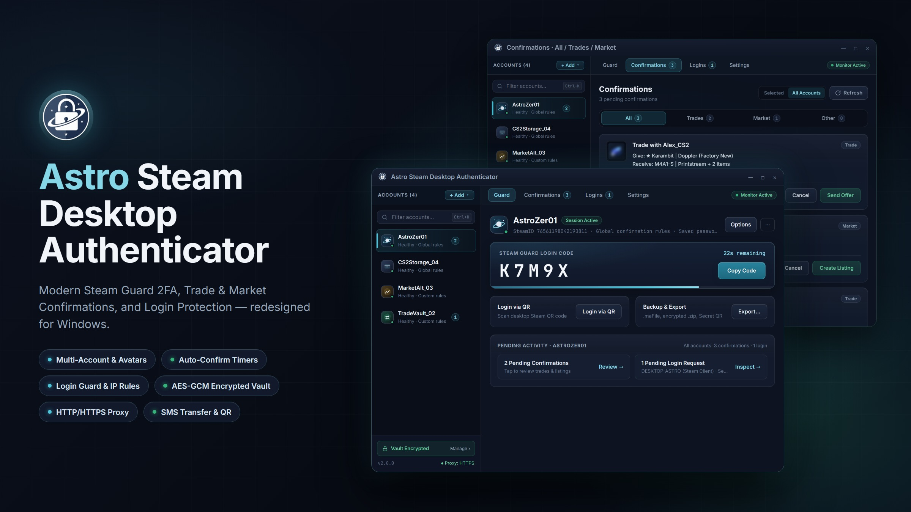

<h1 align="center">
  
  <br/>
  Astro Steam Desktop Authenticator
</h1>

<p align="center">
  A modernized, actively maintained continuation of Steam Desktop Authenticator for Windows. Manage Steam Guard 2FA codes, Trade &amp; Market confirmations, login approvals, and multi-account automation right from your desktop.
</p>

<p align="center">
  <a href="https://github.com/AstroZer01/Astro-Steam-Desktop-Authenticator/releases/latest">
    
  </a>
</p>

<p align="center">
  
  
  
  
</p>

<p align="center">
  Using Astro Steam Desktop Authenticator? Give the project a ⭐ Star and Watch the repo for releases and important updates.
</p>

<p align="center">
  
</p>

---

## About This Project

**Astro Steam Desktop Authenticator (ASDA)** is an actively maintained continuation of the original [Steam Desktop Authenticator](https://github.com/Jessecar96/SteamDesktopAuthenticator) created by **Jessecar96**. It keeps the desktop authenticator functional, secure, and up to date with Steam's modern authentication and confirmation APIs.

Manage **Steam Guard 2FA**, review or automate **Trade & Market confirmations**, and approve or deny **Steam login requests** directly on your PC without needing a mobile phone. All credit for the original design and foundation goes to Jessecar96 and the original contributors.

---

## Key Features

- **Redesigned Desktop Interface & Steam Avatars** — Modern slate-navy & glacier-teal desktop UI with a resizable split-pane layout, persistent multi-account sidebar with cached Steam profile avatars, quick `Ctrl+K` account filtering, compact mode, and a cascading system tray account switcher.
- **Steam Guard 2FA & Account Management** — Generate, copy, and manage Steam Guard codes for multiple accounts, with vault encryption, session health indicators, and seamless expired-session renewal.
- **Phone-Free Setup & SMS Authenticator Transfer** — Set up a new authenticator without a phone number when Steam allows it (with guided email/SMS steps when required), or transfer an existing Steam Guard Mobile Authenticator into ASDA via SMS with crash-safe recovery.
- **Trade & Market Confirmations** — Filter confirmations across **All**, **Trades**, and **Market** tabs with framed Steam item thumbnails, non-blocking refresh, and configurable **per-account auto-confirm timers** backed by a progressive rate-limit-aware scheduler.
- **Login Approvals & Protection Rules** — Review incoming Steam login requests with device, IP, and location details, then approve or deny manually or via automatic account rules with IP allowlisting.
- **Opt-In Silent Re-Login & Encrypted Vault** — Store credentials in an opt-in AES-GCM encrypted store to automatically renew expired Steam sessions in the background, and rely on crash-safe, single-transaction canonical `.maFile` storage.
- **Backup & Secret QR Export** — Export account backups and view/export authenticator secrets via a native QR dialog, plus tokenless `.maFile` import support.
- **Proxy Support** — Route Steam and avatar traffic through HTTP or HTTPS proxies (with optional authentication, IPv6 support, and built-in proxy testing).
- **Desktop Notifications & Update Checks** — Receive Windows notifications for pending confirmations and login requests, with optional automatic or manual update checks in Settings.

---

## Quick Start (Recommended)

If you just want to run ASDA without compiling from source:

1. Download the latest `ASDA-Release-*.zip` from the [**Releases page**](https://github.com/AstroZer01/Astro-Steam-Desktop-Authenticator/releases/latest).
2. Extract the archive to a writable folder on your PC (avoid `Program Files`).
3. Run `Steam Desktop Authenticator.exe`.

> **Runtime requirements:** Windows 10 or 11 (64-bit), the [.NET 8 Desktop Runtime](https://dotnet.microsoft.com/download/dotnet/8.0), and the [Microsoft Edge WebView2 Runtime](https://developer.microsoft.com/microsoft-edge/webview2/#download-section) (pre-installed on Windows 11).

---

## Build from Source (Windows)

The compiled UI stylesheet and fonts are committed to the repository, so **Node.js is not required** for a standard release build.

### Prerequisites

- **Windows 10 or 11 (64-bit)**
- **[.NET 8 SDK](https://dotnet.microsoft.com/download/dotnet/8.0)**
- **[Microsoft Edge WebView2 Runtime](https://developer.microsoft.com/microsoft-edge/webview2/#download-section)** (already included on Windows 11)

### Quick Build (Command Line)

1. **Clone the repository:**

   ```powershell
   git clone https://github.com/AstroZer01/Astro-Steam-Desktop-Authenticator.git
   cd Astro-Steam-Desktop-Authenticator
   ```

2. **Publish the portable release package:**

   ```powershell
   dotnet publish "Launcher\Launcher.csproj" -c Release -r win-x64 --self-contained false `
     -p:PublishSingleFile=true -p:IncludeNativeLibrariesForSelfExtract=false `
     -p:PublishTrimmed=false -p:EnableCompressionInSingleFile=false `
     -p:DebugSymbols=false -o "publish\ASDA"
   ```

   *(Close any running instance from `publish\ASDA` before rebuilding. Existing `publish\ASDA\maFiles` data is preserved.)*

3. **Launch the app:**

   ```powershell
   .\publish\ASDA\Steam Desktop Authenticator.exe
   ```

> **Portable folder structure:** Keep the entire `publish\ASDA` folder together in a writable directory (not `Program Files`). The root executable is the Launcher; it runs the main app from `bin\` and stores your accounts in `maFiles\` next to the Launcher on first run.

### Other Build Options

<details>
<summary><strong>Build with Visual Studio 2022</strong></summary>

1. Open `SteamDesktopAuthenticator.sln` in Visual Studio 2022.
2. Switch the build configuration to **Release**.
3. In Solution Explorer, right-click **Launcher** *(not `Steam Desktop Authenticator`)* and select **Publish**.
4. Choose **Folder** → set the target location to `publish\ASDA` → set Target Runtime to **win-x64** and Deployment Mode to **Framework-dependent**.
5. Under publish settings, enable **Produce single file**, keep trimming disabled, and click **Publish**.

</details>

<details>
<summary><strong>Reusable Windows Build Script (.bat)</strong></summary>

Save this as a `.bat` file, set `PROJECT_ROOT` to your cloned repo path and `OUTPUT` to your target folder, and run it whenever you want a clean rebuild without touching `maFiles`:

```bat
@echo off
setlocal EnableExtensions
title Build Astro Steam Desktop Authenticator

set "PROJECT_ROOT=C:\path\to\Astro-Steam-Desktop-Authenticator"
set "OUTPUT=%PROJECT_ROOT%\publish\ASDA"

cd /d "%PROJECT_ROOT%" || goto :failed

dotnet clean "SteamDesktopAuthenticator.sln" -c Release || goto :failed
dotnet publish "Launcher\Launcher.csproj" -c Release -r win-x64 --self-contained false -p:PublishSingleFile=true -p:IncludeNativeLibrariesForSelfExtract=false -p:PublishTrimmed=false -p:EnableCompressionInSingleFile=false -p:DebugSymbols=false -o "%OUTPUT%" || goto :failed

del /q "%OUTPUT%\*.pdb" "%OUTPUT%\*.xml" "%OUTPUT%\*.config" 2>nul
del /q "%OUTPUT%\bin\*.pdb" "%OUTPUT%\bin\*.xml" "%OUTPUT%\bin\*.config" 2>nul

echo.
echo Build completed: %OUTPUT%
pause
exit /b 0

:failed
echo.
echo Build failed. Close any running copy of the app and try again.
pause
exit /b 1
```

</details>

<details>
<summary><strong>UI Development (Tailwind CSS 4 — Contributors Only)</strong></summary>

Only needed if you modify HTML templates, `tailwind.config.js`, or `ui/tailwind-input.css`. Requires **[Node.js 22 LTS](https://nodejs.org/)**:

```powershell
npm ci            # First time or after package-lock.json changes
npm run build:ui  # Regenerates Steam Desktop Authenticator/ui/assets/css/app.css
npm run check:ui  # Verifies the generated CSS matches what is committed
```

Commit the regenerated `Steam Desktop Authenticator/ui/assets/css/app.css` alongside your UI changes.

</details>

### Running Tests

```powershell
dotnet test SteamDesktopAuthenticator.sln -c Release
```

---

## Roadmap

- [ ] API endpoint for trading automation

---

## Security & Disclaimer

- **Back up your `maFiles` folder and `manifest.json` securely.** They contain your 2FA secrets. Never commit them to a repository or share them with anyone.
- This software is provided as-is with no warranty. You use it at your own risk and are responsible for safeguarding your backups and computer access.

**Notice:** Astro Steam Desktop Authenticator is an unofficial open-source project and is not affiliated with, endorsed by, or associated with Valve Corporation or the official Steam Guard mobile app.
